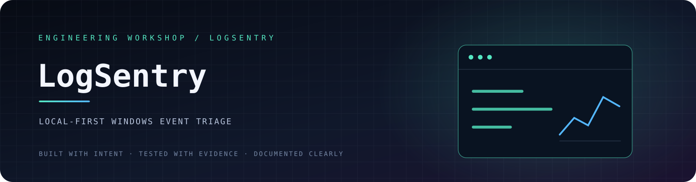
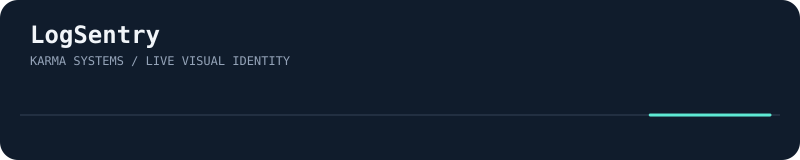
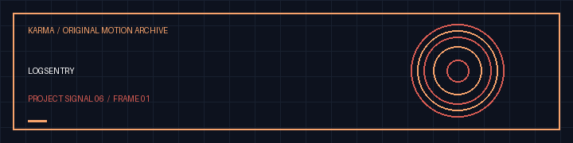

<!-- VISHWAS.EXE UNIFIED THEME START -->
<p align="center"><a href="https://github.com/vishwasaithalz/LogSentry"></a></p>
<p align="center"><strong>VISHWAS.EXE / LogSentry</strong><br/>Local-first defensive Windows event learning<br/><sub>Designed and built by <strong>Vishwas Aithal</strong> · Same computer universe, its own personality</sub></p>
<p align="center">
  <a href="https://vishwasaithalz.github.io/vishwasaithalz/"><strong>💾 BOOT MANAGER</strong></a> &nbsp;·&nbsp;
  <a href="https://vishwasaithalz.github.io/vishwasaithalz/overload/"><strong>🖥️ OVERLOAD OS</strong></a> &nbsp;·&nbsp;
  <a href="https://vishwasaithalz.github.io/vishwasaithalz/arcade/"><strong>🎮 ARCADE</strong></a> &nbsp;·&nbsp;
  <a href="https://github.com/vishwasaithalz?tab=repositories"><strong>📁 ALL PROJECTS</strong></a> &nbsp;·&nbsp;
  <a href="https://vishwasaithal.ai.studio/"><strong>🌐 PORTFOLIO</strong></a>
</p>
<!-- VISHWAS.EXE UNIFIED THEME END -->

<details>
<summary><strong>🎞 Open legacy project visuals and original navigation</strong></summary>

<p align="center"><a href="https://github.com/vishwasaithalz/LogSentry"></a></p>
<p align="center"><strong>🛡️ LogSentry</strong> · Defensive Windows event triage</p>
<p align="center">
<a href="https://github.com/vishwasaithalz/LogSentry/pull/2"></a>
<a href="https://vishwasaithalz.github.io/vishwasaithalz/arcade/#terminal"></a>
</p>

<details><summary>🎨 Open original full-size project artwork</summary>
<p align="center"></p>
</details>

</details>

<p align="center">
  <a href="https://github.com/vishwasaithalz/LogSentry/actions/workflows/tests.yml"></a>
  
  
  
</p>

<p align="center"><strong>Turn exported Windows event data into a clearer investigation starting point.</strong></p>

<p align="center"><a href="#-overview">Overview</a> · <a href="#-quick-start">Quick start</a> · <a href="#-example-workflow">Examples</a> · <a href="#-privacy--safety">Safety</a> · <a href="#-roadmap">Roadmap</a></p>

## 🔍 Overview

LogSentry is a small, local-first Python utility for importing, filtering, and summarising Windows Event Log data that you explicitly export. It is designed as a learning and triage helper, not an endpoint detection product.

### What it does

- Imports exported event data in JSON or CSV.
- Normalises common event fields such as event ID, timestamp, provider, level, and message.
- Filters by event ID, level, provider, and time window.
- Produces readable text or machine-readable JSON summaries.
- Includes synthetic sample data and offline unit tests.

## ⚡ Quick start

**Requirements:** Python 3.10 or newer. No third-party runtime packages.

```powershell
git clone https://github.com/vishwasaithalz/LogSentry.git
cd LogSentry
py -3 -m logsentry samples/security-events.json
```

JSON output:

```powershell
py -3 -m logsentry samples/security-events.json --format json
```

Save a report directly to a file:

```powershell
py -3 -m logsentry samples/security-events.json --format json --output reports\triage.json
```

CSV input:

```powershell
py -3 -m logsentry path\to\export.csv --format text
```

Run tests:

```powershell
py -3 -m unittest discover -s tests -v
```

## 🕵️ Investigation mode

Use a real offline investigation workflow with an exported, authorized event file:

```powershell
py -3 -m logsentry samples/security-events.json --investigate --format text
py -3 -m logsentry samples/security-events.json --investigate --format json --output reports/investigation.json
```

This highlights Event ID 4625 authentication-failure bursts (five events within fifteen minutes by default) and Event ID 4740 account lockouts. It is a starting point, not an automated verdict.

**Interpretation limits:** A burst of failed logons can result from mistyped passwords, stale service credentials, or automated activity; it is not proof of compromise. A lockout event likewise requires corroborating context. Validate the event timestamps, account names, affected hosts, and relevant authentication history before drawing conclusions. Use synthetic data for public demonstrations and avoid publishing sensitive exported event records. Review source timestamps, accounts and machine context locally. No upload, live collection or privileged access is performed.

## 🧭 Example workflow

1. Export only the Windows events you are authorised to review using Event Viewer or an approved administrative process. LogSentry accepts JSON or CSV, not native `.evtx` files. Convert an authorised export to one of the supported formats locally before running the tool; do not rename an `.evtx` file to `.json` or `.csv`.
2. Save the export locally as JSON or CSV.
3. Run LogSentry against that file.
4. Review the summary in context. Event IDs and severity labels are clues, not verdicts.

**Before sharing a report:** use synthetic fixtures for public examples. For real investigations, keep raw exports private and remove account names, computer names, IP addresses, message contents, and other identifying fields from any excerpts you are authorised to disclose.

## 🛡️ Privacy & safety

- No automatic subscription to Windows Event Log.
- No privilege elevation, network requests, telemetry, or data upload.
- Use synthetic data for demonstrations.
- Remove personal, customer, host, and organisational details before sharing reports.

This initial version is an offline parser. It is not a forensic suite, EDR, automated incident response system, or proof of compromise.

## 🧱 Project structure

```text
logsentry/       Parser, normalisation, filters and CLI
samples/         Synthetic event data
tests/           Offline unit tests
.github/         CI workflow
```

## 🗺️ Roadmap

- [ ] Add more real-world export-format fixtures using sanitised synthetic data.
- [ ] Improve field mapping and parser diagnostics.
- [ ] Add investigation report export options.
- [ ] Document an optional Windows export helper without collecting data automatically.
- [ ] Add a small read-only dashboard only after the CLI behaviour is stable.

## 🤝 Contributing

Focused bug reports and reproducible test cases are welcome. Read [CONTRIBUTING.md](CONTRIBUTING.md) and [SECURITY.md](SECURITY.md) first.

<p align="center"><sub>Built for careful investigation. Local data stays local.</sub></p>


<!-- KARMA VISUAL IDENTITY: START -->
<div align="center">

**DEFENSIVE SECURITY / LOG ANALYSIS**

 

<sub>Designed for clarity. Built for evidence. No invented status metrics.</sub>

</div>
<!-- KARMA VISUAL IDENTITY: END -->


<!-- KARMA ANIMATED SIGNAL -->
<p align="center"></p>
<details><summary><strong>🎛 Explore the interactive Vishwas Aithal universe</strong></summary><p><a href="https://karma-ops-monitor.vercel.app">Launch the music-enabled Vishwas Aithal homepage</a>. Sound is user-controlled. Motion can be reduced.</p></details>


<!-- KARMA AVATAR GALLERY -->
<p align="center"></p>
<p align="center"><a href="https://karma-ops-monitor.vercel.app/#gallery">Explore the animated project gallery</a></p>


### Original motion gallery



[Download this project's GIF](assets/karma-motion.gif) · [View the animated SVG](assets/karma-signal.svg)
